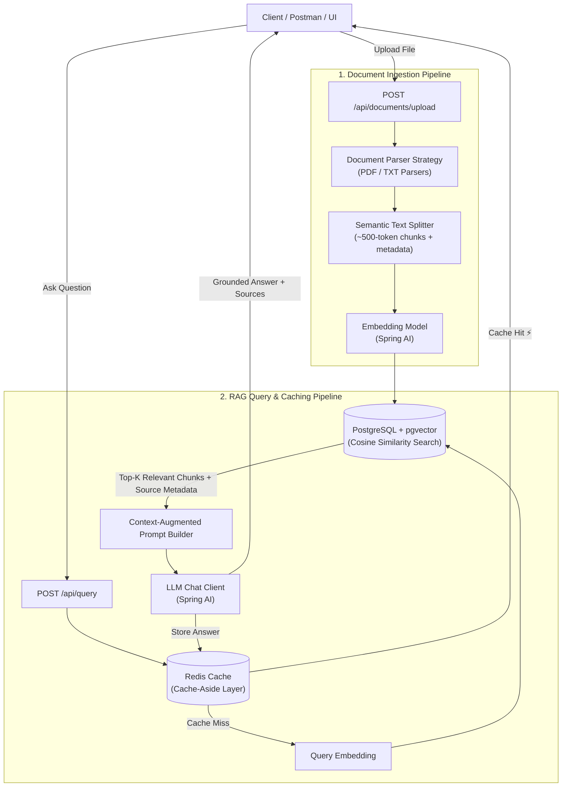
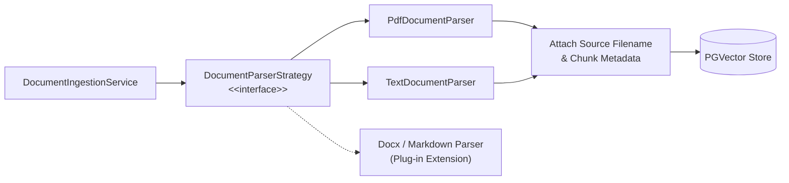

# 🧠 Second Brain — AI Knowledge Base (RAG Backend)

[](https://openjdk.org/)
[](https://spring.io/projects/spring-boot)
[](https://spring.io/projects/spring-ai)
[](https://github.com/pgvector/pgvector)
[](https://redis.io/)

A production-oriented **Retrieval-Augmented Generation (RAG)** backend built with **Java, Spring Boot, Spring AI, PostgreSQL (`pgvector`), and Redis**. Upload domain documents (PDF, TXT), index semantic vector embeddings, and query your personal knowledge base with fast cache-backed, source-attributed answers.

---

## 🏗️ System Architecture



---

## 🧩 Low-Level Design: Extensible Ingestion (Strategy Pattern)

To follow the **Open/Closed Principle**, document parsing is decoupled from ingestion orchestration. Adding support for new formats (e.g., Markdown, DOCX, HTML) requires only adding a new strategy implementation—without modifying `DocumentIngestionService`.



---

## ✨ Key Engineering Highlights

- **Grounded RAG Pipeline:** Eliminates LLM hallucinations by grounding responses strictly in retrieved document chunks via cosine similarity search in PostgreSQL `pgvector`.
- **Strategy Pattern Ingestion:** Cleanly separates file-type parsing (`.pdf`, `.txt`) from chunking and vector persistence, keeping the ingestion layer modular and testable.
- **500-Token Semantic Chunking & Metadata:** Splits large documents into context-preserving chunks while preserving source filename metadata for transparent answer attribution.
- **Redis Cache-Aside Optimization:** Caches repeated natural-language queries in Redis to bypass redundant embedding generation, vector lookups, and LLM API calls—cutting both latency and token costs.
- **Production Error Handling:** Guards against malformed files, null metadata edge cases during PDF parsing, and serialization mismatches in Redis caching.

---

## 🛠️ Tech Stack

| Layer | Technology | Purpose |
| :--- | :--- | :--- |
| **Language & Core** | Java, Spring Boot | REST APIs, Dependency Injection, Service Orchestration |
| **AI Framework** | Spring AI | LLM ChatClient, EmbeddingClient, `TokenTextSplitter`, VectorStore |
| **Vector Database** | PostgreSQL + `pgvector` | Persistent vector storage & cosine similarity retrieval |
| **Caching Layer** | Redis | Low-latency caching for repeated queries |
| **Build & Testing** | Maven, Postman, Swagger | Dependency management & API verification |

---

## 📡 API Overview

> *Update these paths to match your exact Spring `@RestController` mappings.*

| Method | Endpoint | Description |
| :--- | :--- | :--- |
| `POST` | `/api/documents/upload` | Uploads a `.pdf` or `.txt` file, chunks content, and stores embeddings in `pgvector` |
| `POST` | `/api/query` | Checks Redis cache; on miss, runs vector similarity search + LLM generation and caches the result |

### Sample Query Request & Response

```json
// POST /api/query
{
  "question": "What is the principle of least privilege in AWS IAM?"
}
```

```json
{
  "answer": "The principle of least privilege grants users and services only the minimum IAM permissions required to perform their specific tasks...",
  "sources": ["aws-notes.txt"],
  "cacheHit": false
}
```

---

## 🚀 Getting Started

### Prerequisites

- **Java 17+** & **Maven 3.8+**
- **PostgreSQL** with the [`pgvector`](https://github.com/pgvector/pgvector) extension enabled
- **Redis** server running locally (default port `6379`)
- Valid LLM / Embedding API key

### 1. Start PostgreSQL (`pgvector`) & Redis via Docker

```bash
# PostgreSQL with pgvector
docker run -d --name pgvector-db \
  -e POSTGRES_DB=secondbrain \
  -e POSTGRES_USER=postgres \
  -e POSTGRES_PASSWORD=postgres \
  -p 5432:5432 pgvector/pgvector:pg16

# Redis
docker run -d --name redis-cache -p 6379:6379 redis:7-alpine
```

### 2. Configure Environment Variables

Set your credentials in `src/main/resources/application.properties` (or pass via environment variables):

```properties
spring.datasource.url=jdbc:postgresql://localhost:5432/secondbrain
spring.datasource.username=postgres
spring.datasource.password=postgres

spring.data.redis.host=localhost
spring.data.redis.port=6379

spring.ai.openai.api-key=${AI_API_KEY}
```

### 3. Clone & Run

```bash
git clone [https://github.com/Abhisii/YOUR_REPO_NAME.git](https://github.com/Abhisii/YOUR_REPO_NAME.git)
cd YOUR_REPO_NAME
mvn clean spring-boot:run
```

---

## 📸 Demo *(Optional — Add Screenshots Here)*

| Cache Miss (Vector Search + LLM) | Cache Hit (Redis ⚡) |
| :---: | :---: |
| *Add Postman screenshot showing response time* | *Add Postman screenshot showing sub-50ms cached response* |

---

## 🗺️ Planned Enhancements

- [ ] Hybrid search combining keyword (BM25) + vector similarity for higher recall
- [ ] Server-Sent Events (SSE) token streaming for real-time answer rendering
- [ ] Multi-user workspace isolation with Spring Security + JWT authentication
- [ ] Docker Compose file for one-command local boot

---

## 👨‍💻 Author

**Abhishek Sharma** — Backend Engineer (Java, Spring Boot, AI Systems)  
[](https://www.linkedin.com/in/abhishek-sharma021202/)
[](https://github.com/Abhisii)
